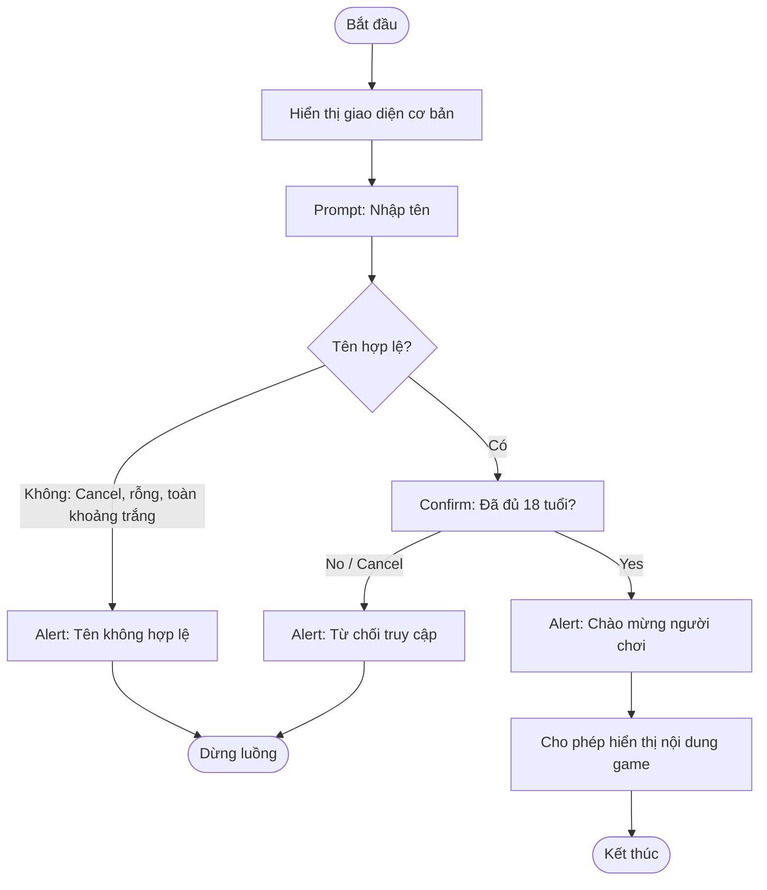

# FastGuard – Cổng an ninh tương tác HeroQuest

## 1. Giới thiệu

Dự án thực hành tối ưu quá trình tải trang HeroQuest và xây dựng luồng tương tác xác nhận người chơi từ 18 tuổi trở lên bằng JavaScript.

## 2. Mục tiêu

- Hiểu nguyên nhân **render-blocking** khi đặt JavaScript đồng bộ trong `<head>`.
- Tách JavaScript nội tuyến thành file `app.js` (External JS).
- Sử dụng `defer` để không chặn quá trình phân tích HTML trong lúc tải script.
- Sử dụng `prompt()`, `confirm()`, `alert()` và xử lý các trường hợp ngoại lệ.

## 3. Cấu trúc thư mục

```text
fastguard-heroquest/
├── index.html         # Cấu trúc giao diện, liên kết app.js
├── app.js             # Logic tương tác và kiểm tra điều kiện truy cập
├── README.md          # Tài liệu dự án
└── ai_prompt_log.md   # Nhật ký các prompt thực tế đã trao đổi với AI
```

## 4. Phân tích mã nguồn ban đầu

| Vấn đề | Nguyên nhân | Hướng xử lý |
|---|---|---|
| Giao diện hiển thị chậm | Script đồng bộ trong `<head>` chạy vòng lặp rất lớn trước khi trình duyệt phân tích `<body>` | Bỏ tác vụ giả lập nặng; tách script và dùng `defer` |
| Hiển thị `Chào null` | Không kiểm tra khi người dùng bấm Cancel | Kiểm tra giá trị `null` |
| Chấp nhận tên trống | Không kiểm tra chuỗi rỗng hoặc toàn dấu cách | Dùng `trim()` và kiểm tra kết quả |
| Người chưa đủ tuổi vẫn được vào | Nhánh `confirm() === false` không từ chối truy cập | Chặn luồng hiển thị/nội dung game khi không xác nhận đủ tuổi |

## 5. Thiết kế luồng tương tác



**Chú ý:** Nội dung game cần được ẩn hoặc khóa trước khi xác thực và chỉ mở sau khi người chơi xác nhận đủ tuổi. Hộp thoại `confirm()` chỉ thu thập lời tự xác nhận, không xác minh tuổi thực tế.

## 6. Phương án nhúng JavaScript

Trong `index.html`, sử dụng file JavaScript ngoài với `defer`:

```html
<script src="app.js" defer></script>
```

- `defer`: tải script song song với quá trình phân tích HTML, thực thi sau khi HTML đã được phân tích; giữ thứ tự giữa các script `defer` cổ điển.
- `async`: tải song song nhưng thực thi ngay khi sẵn sàng, có thể chen ngang quá trình phân tích HTML; không bảo đảm thứ tự giữa các script `async`.
- Đặt script cuối `<body>`: cũng tránh chặn việc phân tích phần lớn HTML phía trên, nhưng script chỉ bắt đầu được tải khi trình duyệt gặp thẻ đó.

**Lựa chọn:** `defer`, vì logic cần làm việc với các phần tử HTML sau khi chúng được phân tích.

## 7. Kiểm thử

| Trường hợp | Kết quả mong đợi |
|---|---|
| Tải lại trang (F5) | HTML cơ bản được phân tích mà không bị vòng lặp nặng chặn |
| Prompt → Cancel hoặc ESC | Thông báo tên không hợp lệ, dừng luồng |
| Prompt → OK với chuỗi rỗng | Thông báo tên không hợp lệ, dừng luồng |
| Nhập toàn dấu cách | Thông báo tên không hợp lệ, dừng luồng |
| Nhập tên hợp lệ, Confirm → No/Cancel | Thông báo từ chối; không mở nội dung game |
| Nhập tên hợp lệ, Confirm → Yes | Thông báo chào mừng; mở nội dung game |

*Bảng trên là tiêu chí kiểm thử dự kiến; cần chạy thực tế và ghi nhận kết quả sau khi hoàn thiện mã nguồn.*

## 8. Kiến thức bảo vệ bài

**Vì sao chọn `defer` thay vì `async`?** Vì `defer` thực thi sau khi HTML được phân tích, phù hợp với mã cần truy cập DOM và giữ thứ tự thực thi của các script `defer` cổ điển.

**Giá trị trả về của các hộp thoại:**

| Hàm | Giá trị trả về |
|---|---|
| `alert()` | `undefined` |
| `prompt()` | Chuỗi người dùng nhập (có thể là `""`) hoặc `null` khi hủy |
| `confirm()` | `true` khi OK, `false` khi Cancel |

## 9. Sản phẩm nộp bài

- [x] `index.html` – giao diện và nhúng External JS đúng chuẩn.
- [x] `app.js` – xử lý đầy đủ luồng tương tác và ngoại lệ.
- [x] `README.md` – mô tả bài thực hành, thiết kế và tiêu chí kiểm thử.
- [x] `ai_prompt_log.md` – ghi lại trung thực các prompt đã sử dụng, mục đích và kiến thức rút ra.
- [ ] Chạy thử và kiểm tra lỗi bằng trình duyệt/DevTools.

## 10. Tiêu chí chấm điểm

- **40%:** Chất lượng sản phẩm và luồng tương tác.
- **40%:** Vấn đáp về `defer`, `async`, `alert`, `prompt`, `confirm`.
- **20%:** Nhật ký sử dụng AI và khả năng phân tích trường hợp ngoại lệ.

> README này là tài liệu thiết kế và hướng dẫn thực hiện; không khẳng định mã nguồn đã được triển khai hay kiểm thử thành công.
